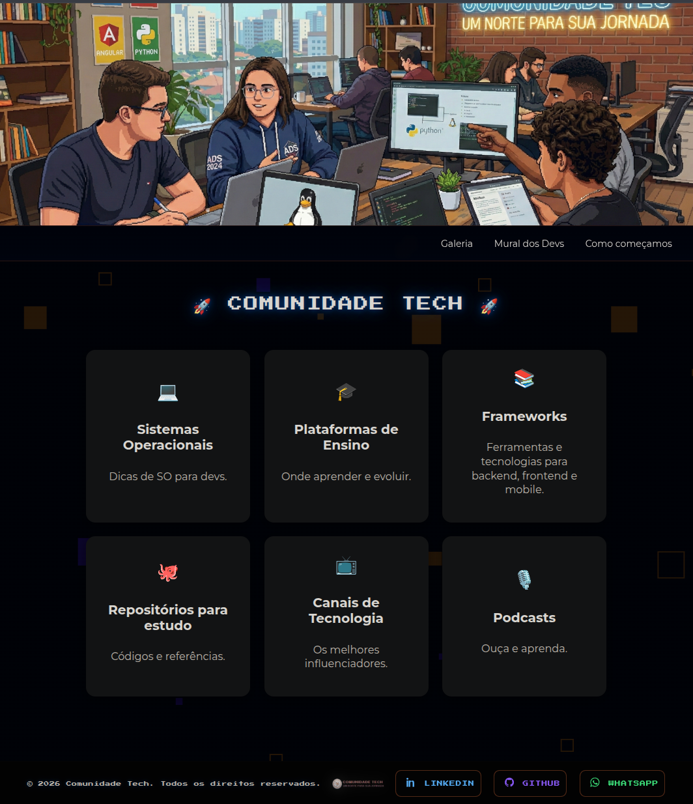

# 🚀 Comunidade Tech — Um Norte Para Sua Jornada

[](https://angular.dev/)
[](https://openjdk.org/)
[](https://spring.io/projects/spring-boot)
[](https://www.postgresql.org/)
[](https://www.docker.com/)
[](https://firebase.google.com/)
[](https://comunidade.tech.lucivaldo.cloud/inicio)

> Uma plataforma web interativa concebida para orientar, centralizar e acelerar os primeiros passos de quem está ingressando na área de Tecnologia da Informação.

🌐 **Acesse a aplicação em produção:** [comunidade.tech.lucivaldo.cloud](https://comunidade.tech.lucivaldo.cloud/inicio)

---

## 🧭 Sumário Rápido
1. [Visão Geral da Plataforma](#-visão-geral-da-plataforma)
2. [Estrutura do Repositório (Monorepo)](#-estrutura-do-repositório-monorepo)
3. [Tabela de Portas, URLs e Acessos Locais](#-tabela-de-portas-urls-e-acessos-locais)
4. [Como Subir Tudo de Uma Vez (Fullstack Completo)](#-como-subir-tudo-de-uma-vez-fullstack-completo)
5. [Como Fazer o Deploy (Firebase Hosting)](#-como-fazer-o-deploy-firebase-hosting)
6. [Recursos e Módulos da Plataforma](#-recursos-e-módulos-da-plataforma)
7. [Documentações Detalhadas](#-documentações-detalhadas)

---

## 🖼️ Visão Geral da Plataforma



---

## 📂 Estrutura do Repositório (Monorepo)

O projeto é estruturado em módulos independentes e desacoplados:

```text
comunidade-tech/
├── frontend/             # 🅰️ SPA Angular 21 (Standalone Components, Signals, Pixel Art)
│   ├── src/              # Código-fonte, componentes, páginas e serviços
│   ├── public/           # Assets visuais, imagens e favicon
│   ├── angular.json      # Configurações do Angular CLI
│   └── package.json      # Dependências e scripts npm
├── backend/              # ☕ REST API Java 21 LTS + Spring Boot 3.3.4 (Project Loom)
│   ├── src/main/java/    # Controladores REST, Serviços, DTOs e Entidades JPA
│   ├── src/test/java/    # Testes unitários com JUnit 5 e Mockito
│   ├── Dockerfile        # Build multi-stage enxuto (Eclipse Temurin 21 Alpine)
│   └── pom.xml           # Gerenciamento de dependências Maven
├── database/             # 🗄️ PostgreSQL 16 (Scripts de Inicialização e Schemas)
│   ├── init.sql          # Schemas das tabelas, índices e seed inicial
│   └── README.md         # Documentação da modelagem de dados
├── docs/                 # 📚 Documentações Técnicas e Arquiteturais
│   └── DOCUMENTACAO.md   # Guia detalhado da plataforma
├── docker-compose.yml    # Orquestração local de Containers (PostgreSQL, Adminer, Spring Boot API)
├── firebase.json         # Configuração de Deploy no Firebase Hosting e Firestore
└── firestore.rules       # Regras de segurança de acesso aos dados NoSQL
```

---

## 🌐 Tabela de Portas, URLs e Acessos Locais

| Serviço | Porta Local | URL / Endpoint | Descrição |
| :--- | :--- | :--- | :--- |
| **Frontend (Angular)** | `4200` | `http://localhost:4200` | Interface SPA interativa |
| **Backend API (Spring Boot)** | `8080` | `http://localhost:8080` | Endpoints REST da comunidade |
| **Swagger UI / OpenAPI** | `8080` | `http://localhost:8080/swagger-ui.html` | Documentação interativa da API |
| **PostgreSQL Database** | `5433` | `localhost:5433` (`db: comunidade_tech`) | Banco relacional |
| **Adminer (DB Web Admin)** | `8085` | `http://localhost:8085` | Painel gráfico para o PostgreSQL |
| **H2 In-Memory (Dev API)** | `8080` | `http://localhost:8080/h2-console` | Banco em memória para dev rápido |

---

## 🚀 Como Subir Tudo de Uma Vez (Fullstack Completo)

Tu tens três formas extremamente práticas de rodar a aplicação: com um único comando Docker (100% contêineres), com um script de desenvolvimento integrado (Live Reload) ou isolando os serviços em abas dedicadas do terminal.

---

### 🐳 Cenário 1: Tudo em Contêineres com Docker Compose (Comando Único)
Ideal para homologação integrada e testes rápidos sem precisar de ferramentas instaladas localmente (nem Java, nem Node):

```bash
docker compose up -d --build
```

> **O que esse comando sobe automaticamente:**
> - 🗄️ **PostgreSQL 16:** Porta `5433` (com o banco `comunidade_tech` e schemas/seeds de `database/init.sql` aplicados).
> - 🗂️ **Adminer:** Interface web do banco disponível em **`http://localhost:8085`**.
> - ☕ **API Spring Boot 3 (Java 21):** Endpoints REST e Swagger UI em **`http://localhost:8080/swagger-ui.html`**.
> - 🅰️ **Frontend Angular 21 (Nginx):** Aplicação completa pronta em **`http://localhost:4200`**.

Para parar todos os contêineres:
```bash
docker compose down
```

---

### ⚡ Cenário 2: Tudo de Uma Vez em Modo Desenvolvimento (Live Reload)
Ideal para a rotina diária de desenvolvimento, onde tu queres modificar código no frontend ou backend e ter recarregamento imediato (*hot-reload*):

```bash
./start-dev.sh
```

> **O que o script automatiza:**
> 1. Inicia o PostgreSQL 16 e o Adminer em segundo plano via Docker.
> 2. Inicia a API Spring Boot 3 com o Maven Wrapper local.
> 3. Dispara o frontend Angular 21 com Live Reload ativo.
> 4. Pressionar `Ctrl + C` encerra com segurança todos os processos simultaneamente.

---

### 💻 Cenário 3: Executar Serviços Isoladamente (Abas Separadas)
Se tu preferires abrir abas individuais no terminal da tua IDE:

#### 1. Terminal 1 — Banco de Dados e Adminer (Docker)
```bash
docker compose up -d db adminer
```

#### 2. Terminal 2 — Backend API (Java 21 + Spring Boot 3)
```bash
cd backend
./mvnw spring-boot:run
```
*(Executa localmente conectado ao Postgres ou com H2 em memória)*

#### 3. Terminal 3 — Frontend SPA (Angular 21)
```bash
cd frontend
npm install   # apenas na primeira vez
npm start
```
Acesse em: **`http://localhost:4200`**

---

## ☁️ Como Fazer o Deploy (Firebase Hosting)

O deploy de produção é mantido no **Firebase Hosting** com suporte a SSL automático e CDN global. A estrutura foi configurada para que o deploy continue funcionando perfeitamente sem quebrar a URL em produção:

```bash
# 1. Compila o frontend Angular
cd frontend
npm run build

# 2. Retorna para a raiz e dispara o deploy no Firebase
cd ..
firebase deploy --only hosting
```

A aplicação entrará no ar imediatamente em **[comunidade.tech.lucivaldo.cloud](https://comunidade.tech.lucivaldo.cloud)**.

---

## ✨ Recursos e Módulos da Plataforma

- 🖥️ **Trilhas de Sistemas Operacionais:** Guias práticos cobrindo Linux, MacOS, Windows (WSL2), FreeBSD e Raspberry Pi com **checklist gamificado** e barra de progresso de XP.
- 💬 **Mural dos Devs:** Feed colaborativo para envio de mensagens com filtros por categoria e contagem de curtidas.
- 🎓 **Plataformas de Ensino & Gamificação:** Diretório com plataformas de estudo e jogos de programação, incluindo indicação ativa da comunidade.
- 🧰 **Frameworks & Ecossistemas:** Guias estratégicos de Frontend, Backend, Mobile e DevOps.
- 🎙️ **Podcasts & Canais:** Recomendações dos melhores criadores de conteúdo do mercado.

---

## 📚 Documentações Detalhadas

- 🅰️ **[Documentação do Frontend](./frontend/README.md)**
- ☕ **[Documentação da API Backend](./backend/README.md)**
- 🗄️ **[Documentação do Banco de Dados](./database/README.md)**
- 📖 **[Documentação Arquitetural Geral](./docs/DOCUMENTACAO.md)**

---

## 👥 Comunidade & Conexões

[](https://discord.gg/7PREG5zDF)
[](https://chat.whatsapp.com/B9BGGB7Z0UcDZaUa0SKznW)
[](https://www.linkedin.com/in/lucivaldojr/)
[](https://github.com/luci-jr)

---

<p align="center">
  Idealizado e mantido por <b><a href="https://www.linkedin.com/in/lucivaldojr/">Lucivaldo Junior</a></b><br>
  <sub>Comunidade Tech • Um norte para sua jornada na tecnologia 🚀</sub>
</p>
